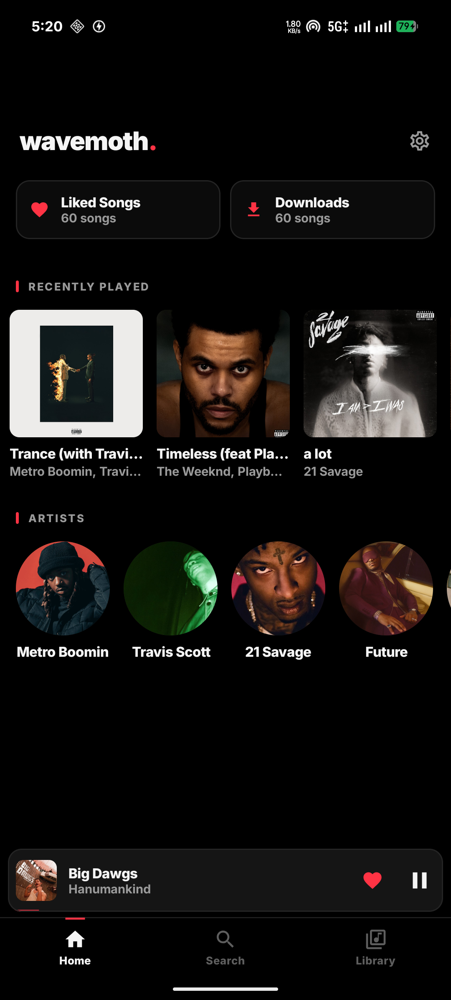
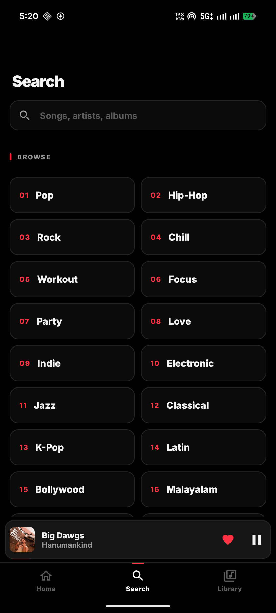
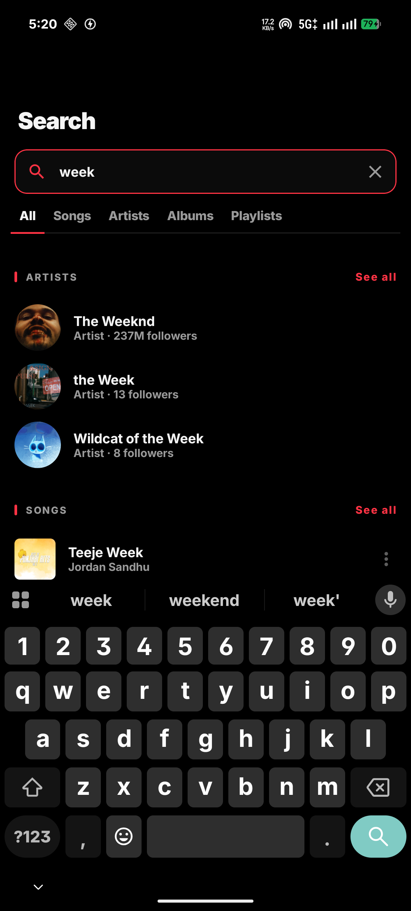
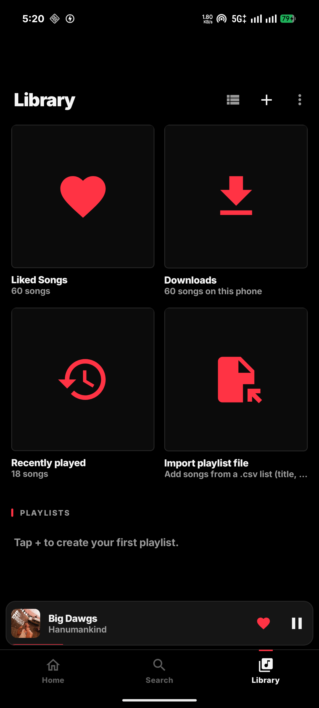
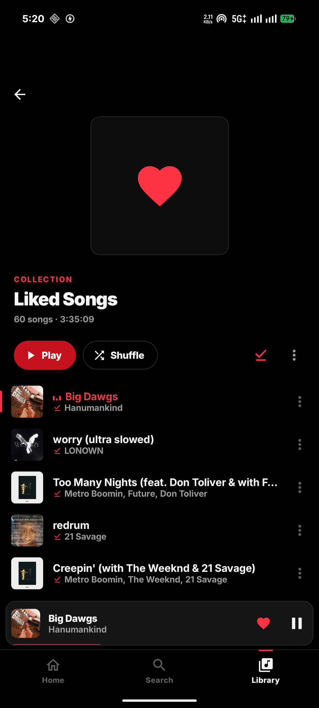
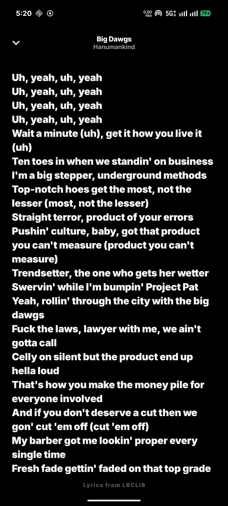
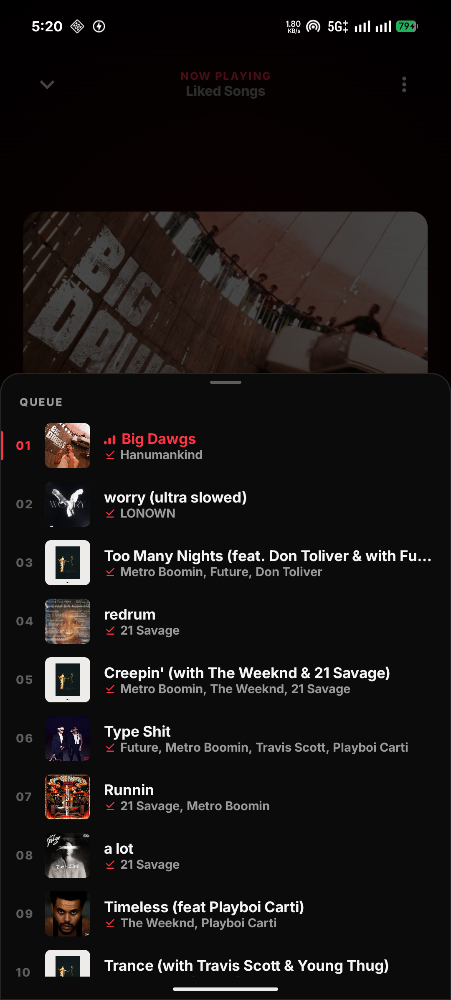

<div align="center">

# Wavemoth

**A music player for Android that streams from YouTube Music. No account, no ads, no sign-in.**

[](LICENSE)


[](https://buymeacoffee.com/abin95x)

<a href="https://github.com/Abin95x/Wavemoth/raw/main/release/Wavemoth.apk"></a>

</div>

> **Unofficial app.** Wavemoth gets its music from YouTube Music through
> [NewPipeExtractor](https://github.com/TeamNewPipe/NewPipeExtractor). It is not made by or affiliated
> with YouTube or Google.

## Contents

- [Why Wavemoth](#why-wavemoth)
- [Screenshots](#screenshots)
- [Features](#features)
- [Install and use](#install-and-use)
- [Privacy](#privacy)
- [FAQ](#faq)
- [Building from source](#building-from-source)
- [How it works](#how-it-works)
- [Contributing](#contributing)
- [Support the project](#support-the-project)
- [License](#license)

## Why Wavemoth

Most music apps want an account, show ads, or lock background play and downloads behind a
subscription. Wavemoth plays the YouTube Music catalogue without any of that. Your liked songs,
playlists and history live on your phone, not on someone's server.

## Screenshots

<p align="center">
  
  
  
  
  
</p>
<p align="center">
  
  
  
  
</p>

## Features

**Listening**
- Search songs, artists, albums and playlists, or browse by genre and mood. The **All** tab shows the top results of each kind together
- Plays in the background and on the lock screen, with media notification controls
- Best audio quality available (Opus up to 160 kbps), cached as it plays
- Queue, shuffle and repeat. The queue always shows the order songs will really play in, shuffle included
- Play next / add to queue from any song. Added songs go before anything autoplay picked
- Mini player: tap to open the full player, swipe left or right to skip songs. The cover in the full player swipes the same way
- Time-synced lyrics from [LRCLIB](https://lrclib.net). Tap a line to jump to it
- Autoplay radio when the queue ends. It picks related songs and weighs in the artists you like and play, songs you skipped, and what you played recently

**Home**
- Shortcuts to Liked Songs and Downloads
- Your 15 most recently played songs
- The artists you like and play most. Tap one to open their page

**Downloads**
- Download any playlist, album or Liked Songs with one tap, or your whole library from Library → ⋮ → Download all songs
- Downloaded songs play without internet. Downloads keep going in the background with a progress notification and resume after a restart
- Remove one song from its ⋮ menu, or all downloads from the Downloads page or Settings

**Library**
- Liked Songs, Downloads, recently played, and your own playlists (create, rename, delete)
- Sort Liked Songs by date added (newest or oldest first), title, artist or duration. Your choice is remembered
- Show the library as a list or a grid of covers
- Import a playlist from a `.csv` file. Each row is matched on YouTube Music
- Import a `.csv` file straight into Liked Songs (Liked Songs → ⋮ → Import from file). Songs you already like aren't added twice
- Export a playlist or Liked Songs as `.csv`
- Back up and restore your whole library as a JSON file

**Settings**
- Stop music when the app is swiped away from Recents (on by default)
- Clear the song and artwork cache. Your library and downloads are kept

## Install and use

1. **[Download the APK](https://github.com/Abin95x/Wavemoth/raw/main/release/Wavemoth.apk)** on your phone and open it.
   Requires Android 8.0 or newer. If Android blocks the install, allow "Install unknown apps" for your
   browser or file manager.
2. Tap **Install**. The APK is signed with a debug key, so Play Protect may warn about an unknown
   developer. Tap **Install anyway**.
3. Open Wavemoth, search for a song and play it. Tap the heart to add it to Liked Songs.

To update, install the new APK over the old one. Your library is kept.

You can also install from a computer, with USB debugging turned on in your phone's developer options:

```bash
adb install -r release/Wavemoth.apk
```

## Privacy

- There's no Wavemoth account and no Wavemoth server. **The developer never receives any of your data.**
- Liked songs, playlists, history and downloads are stored only on your phone.
- Searches and song streams go straight from your phone to YouTube. Lyrics requests send the song's
  title and artist to [LRCLIB](https://lrclib.net).
- No analytics, no ads, no trackers.

## FAQ

**Is it free?**
Yes. No ads, no subscription.

**Do I need a Google or YouTube account?**
No. Wavemoth never asks you to sign in.

**How do I move my library to a new phone?**
Library → ⋮ → **Back up library** saves one JSON file. On the new phone, use **Restore from backup**.
Downloads aren't in the backup; download them again from Library → ⋮ → Download all songs.

**What should a `.csv` playlist file look like?**
A header row with a `title` column. `artist` is strongly recommended; `album` and `youtube_id` are
optional. Rows with a `youtube_id` are added directly; the rest are searched on YouTube Music.

```csv
title,artist
Blinding Lights,The Weeknd
Big Dawgs,Hanumankind
```

**A song won't play.**
Stream links expire, so the app fetches a fresh one and tries again once, then moves to the next
song. If many songs fail, YouTube may have changed something; check for a newer version.

## Building from source

Requirements: JDK 17 or newer and the Android SDK (API 35).

```bash
# Point Gradle at your SDK once
echo "sdk.dir=$HOME/Android/Sdk" > local.properties

./gradlew assembleDebug      # app/build/outputs/apk/debug/app-debug.apk
./gradlew assembleRelease    # app/build/outputs/apk/release/app-release.apk (minified, debug-signed)
```

Install on a connected phone:

```bash
adb install -r app/build/outputs/apk/release/app-release.apk
```

**Tests** run on your computer with Robolectric, so no phone is needed. The UI tests use a fake player
and fake search results, so they don't touch the network.

```bash
./gradlew testDebugUnitTest
```

`YouTubeSourceOnlineTest` calls YouTube for real and only runs with `WAVEMOTH_ONLINE_TESTS=1`.

## How it works

**Project layout** (`app/src/main/java/com/wavemoth/app/`)

| Part | Code |
| --- | --- |
| Catalogue and stream URLs ([NewPipeExtractor](https://github.com/TeamNewPipe/NewPipeExtractor)) | `data/YouTubeSource.kt` |
| Playback service and media session ([Media3](https://developer.android.com/media/media3)) | `playback/PlaybackService.kt` |
| Shuffle that reorders the queue itself, so the queue shows the real play order | `playback/QueueOrder.kt` |
| Where audio comes from: downloads, then the playback cache, then the network | `playback/AudioSources.kt` |
| Offline downloads (Media3 DownloadManager) | `download/Downloads.kt`, `download/DownloadsService.kt` |
| Audio fetched in short ranged requests, so YouTube doesn't throttle it | `playback/ChunkedDataSource.kt` |
| Autoplay radio scoring | `data/Radio.kt`, `data/SkipHistory.kt` |
| Your top artists on Home | `data/TopArtists.kt` |
| Lyrics (LRCLIB + LRC parser) | `data/Lyrics.kt` |
| Library, playlists, backup | `data/LibraryRepository.kt` |
| CSV import / export | `data/PlaylistFile.kt`, `data/PlaylistImporter.kt` |
| UI (Jetpack Compose, Material 3), black and red theme | `ui/`, `ui/theme/Theme.kt` |

## Contributing

Bug reports and pull requests are welcome.

- **Bugs:** open an issue with your phone model, Android version and steps to reproduce.
- **Pull requests:** keep each one focused on a single change and describe what you tested.

By contributing, you agree that your contributions are licensed under the GPL-3.0.

## Support the project

Wavemoth is free, has no ads and doesn't track you. If you enjoy it, you can support it:

<a href="https://buymeacoffee.com/abin95x"></a>

Starring the repo and reporting bugs help too.

## License

Copyright (C) 2026 Abin

This program is free software: you can redistribute it and/or modify it under the terms of the
GNU General Public License as published by the Free Software Foundation, either version 3 of the
License, or (at your option) any later version. See [LICENSE](LICENSE).

Streaming content may be subject to YouTube's Terms of Service. Use it at your own risk.

### Third-party components

| Component | License |
| --- | --- |
| [NewPipeExtractor](https://github.com/TeamNewPipe/NewPipeExtractor) | GPL-3.0 |
| AndroidX, Jetpack Compose, Media3, Navigation, Lifecycle | Apache 2.0 |
| [OkHttp](https://github.com/square/okhttp) | Apache 2.0 |
| [Coil](https://github.com/coil-kt/coil) | Apache 2.0 |
| Kotlin, kotlinx.coroutines | Apache 2.0 |
| Lyrics from [LRCLIB](https://lrclib.net) | Public API |
