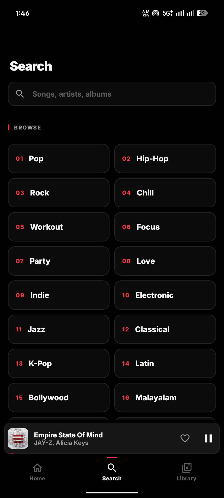
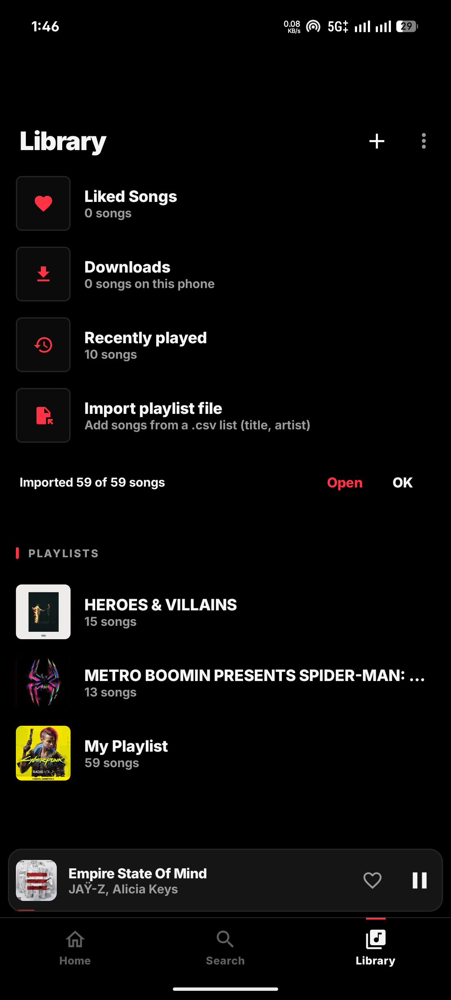
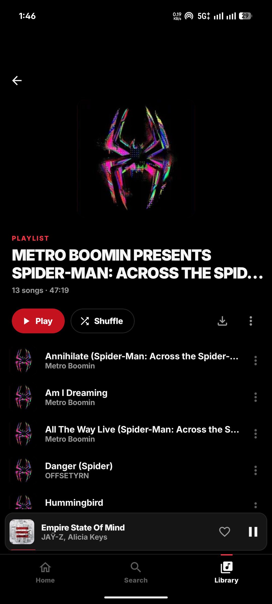
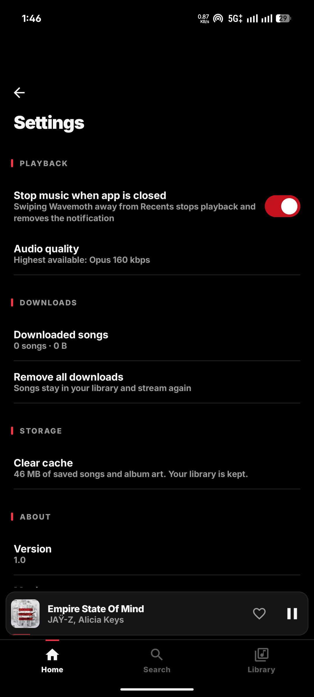
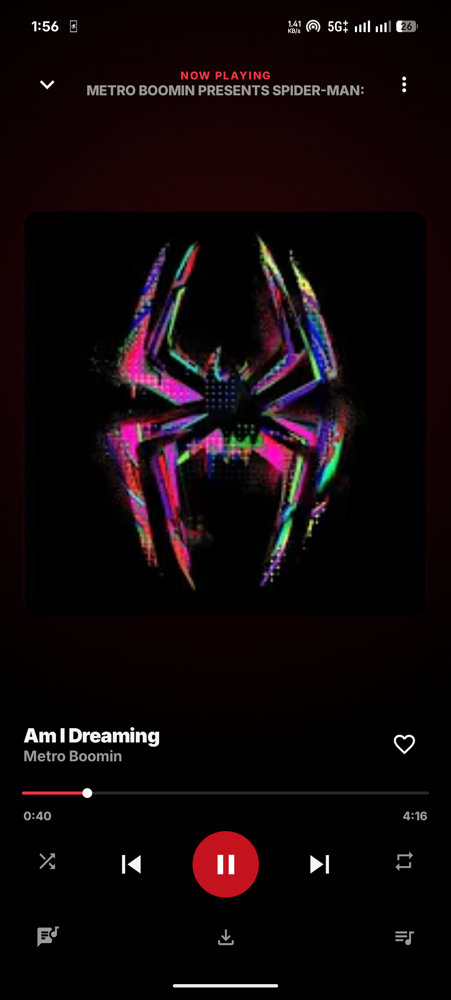
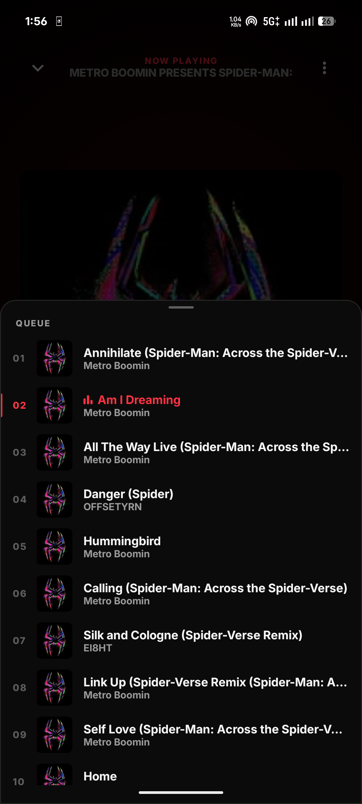

# Wavemoth

A music player for Android that streams from YouTube Music. No account, no ads, no sign-in. Your library lives on your phone.

<a href="https://buymeacoffee.com/abin95x"></a>

<p align="center">
  
  
  
  
  
</p>
<p align="center">
  
  
  
</p>

## Features

**Listening**
- Search songs, artists, albums and playlists, or browse by genre and mood
- Plays in the background and on the lock screen, with media notification controls
- Best audio quality available (Opus up to 160 kbps), cached as it plays
- Queue, shuffle and repeat; play next / add to queue from any song
- Mini player: tap to open the full player, swipe left or right to skip songs (the next song follows your finger in). The cover in the full player swipes the same way
- Time-synced lyrics from [LRCLIB](https://lrclib.net). Tap a line to jump to it
- Autoplay radio when the queue ends. It picks related songs and weighs in the artists you like and play, songs you skipped, and what you played recently

**Downloads**
- Download any playlist, album or Liked Songs with one tap, or your whole library from Library → ⋮ → Download all songs
- Downloaded songs play without internet. Downloads keep going in the background with a progress notification and resume after a restart
- Remove one song from its ⋮ menu, or all downloads from the Downloads page or Settings

**Library**
- Liked Songs, Downloads, recently played, and your own playlists (create, rename, delete)
- Import a playlist from a `.csv` file (title, artist). Each row is matched on YouTube Music
- Export a playlist as `.csv`
- Back up and restore your whole library as a JSON file

**Settings**
- Stop music when the app is swiped away from Recents (on by default)
- Clear the song and artwork cache. Your library and downloads are kept

## Download

**[⬇ Download Wavemoth.apk](https://github.com/Abin95x/Wavemoth/raw/main/release/Wavemoth.apk)** (Android 8.0 or newer)

1. Open the link on your phone and download the APK.
2. Open the file. If Android asks, allow installs from your browser or file manager.
3. Tap **Install**.

Or install it from a computer, with USB debugging turned on in your phone's developer options:

```bash
adb install -r release/Wavemoth.apk
```

The APK is signed with a debug key, so Play Protect may warn about an unknown developer. Tap **Install anyway** to continue. To update, install the new APK over the old one. Your library is kept.

## Build

Requirements: JDK 17 and the Android SDK (API 35).

```bash
# Point Gradle at your SDK once
echo "sdk.dir=$HOME/Android/Sdk" > local.properties

./gradlew assembleDebug      # app/build/outputs/apk/debug/app-debug.apk
./gradlew assembleRelease    # app/build/outputs/apk/release/app-release.apk (minified, debug-signed)
```

Install on a connected phone:

```bash
adb install -r app/build/outputs/apk/release/app-release.apk
```

## Tests

Unit and UI tests run on your computer with Robolectric, so no phone is needed. The UI tests use a fake player and fake search results, so they don't touch the network.

```bash
./gradlew testDebugUnitTest
```

`YouTubeSourceOnlineTest` calls YouTube for real and only runs with `WAVEMOTH_ONLINE_TESTS=1`.

## How it works

| Part | Code |
|---|---|
| Catalogue and stream URLs ([NewPipeExtractor](https://github.com/TeamNewPipe/NewPipeExtractor)) | `data/YouTubeSource.kt` |
| Playback service and media session ([Media3](https://developer.android.com/media/media3)) | `playback/PlaybackService.kt` |
| Where audio comes from: downloads, then the playback cache, then the network | `playback/AudioSources.kt` |
| Offline downloads (Media3 DownloadManager) | `download/Downloads.kt`, `download/DownloadsService.kt` |
| Audio fetched in short ranged requests, so YouTube doesn't throttle it | `playback/ChunkedDataSource.kt` |
| Autoplay radio scoring | `data/Radio.kt`, `data/SkipHistory.kt` |
| Lyrics (LRCLIB + LRC parser) | `data/Lyrics.kt` |
| Library, playlists, backup | `data/LibraryRepository.kt` |
| CSV import / export | `data/PlaylistFile.kt`, `data/PlaylistImporter.kt` |
| UI (Jetpack Compose, Material 3), black and red theme | `ui/`, `ui/theme/Theme.kt` |

Paths are under `app/src/main/java/com/wavemoth/app/`.

## Support

Wavemoth is free. If you enjoy it, you can [buy me a coffee](https://buymeacoffee.com/abin95x) ☕

## Disclaimer

Wavemoth is a personal project and is not affiliated with YouTube or Google. Streaming content may be subject to YouTube's Terms of Service. Use it at your own risk.

## License

Copyright (C) 2026 Abin

Wavemoth is free software, licensed under the [GNU General Public License v3.0](LICENSE). You can use, change and share it. If you share a changed version, it must also be GPL-3.0 and include its source code.

It uses [NewPipeExtractor](https://github.com/TeamNewPipe/NewPipeExtractor), which is also GPL-3.0.
